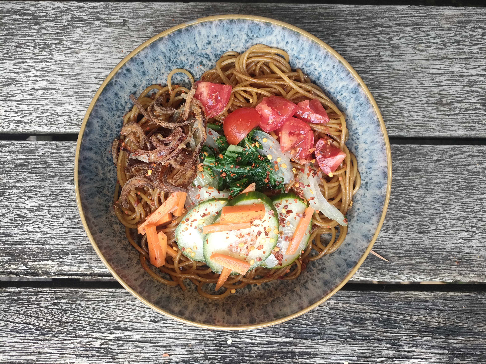
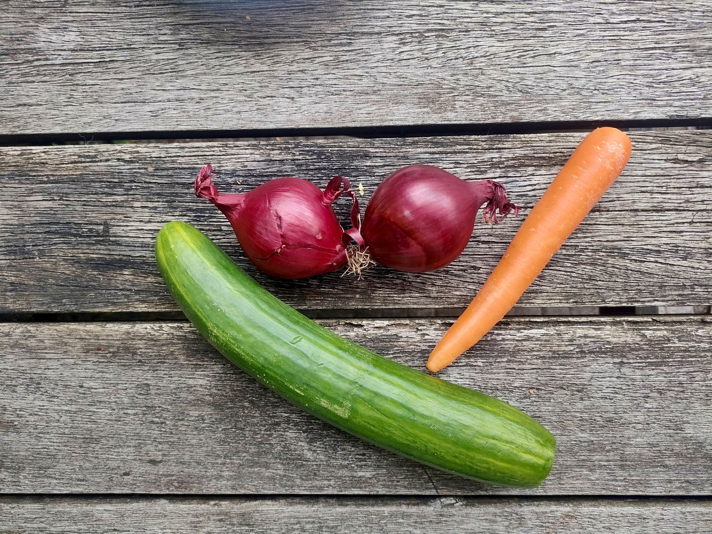
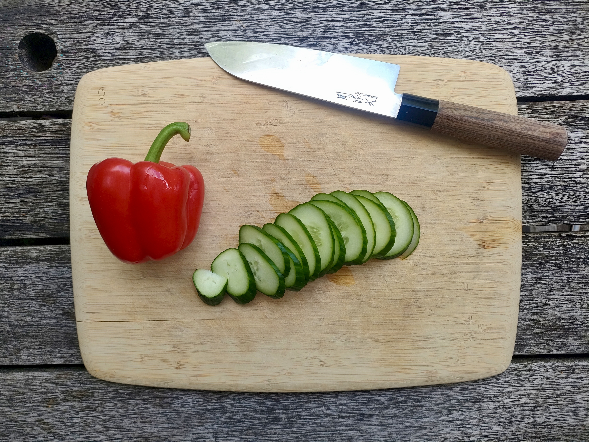

# :material-bowl-mix-outline: Javaanse Bami

{ width="500" height="500" }

Dit recept heb ik [hier gevonden](https://culinessa.com/surinaamse-javaanse-bami/). Ik heb het een klein beetje aangepast, maar de variatie zit vooral in wat je erbij maakt. Ik vind zoet-zure komkommers lekker. Hier op de foto heb ik er ook uienringen gefrituurd.      

### :octicons-list-unordered-16: Ingrediënten

* 250 gr spaghetti 
* olie
* 1 ui
* 3 tenen knoflook 
* gember in kleine stukjes gesneden
* 3 salam blaadjes
* 4 EL zoete ketjap (manis)
* 2 EL zoute ketjap (asin)
* 1/2 bouillonblokje 
* 80 ml kookvocht van de spaghetti 

### :material-book-clock: Bereiding

{ width="340" height="100" }
{ width="340" height="100" }

Kook de spaghetti maar niet helemaal gaar (ca. 7 minuten). Bak ui, knoflook, salam blaadjes en gember in de olie voor een paar minuten. Voeg de ketjap manis en asin, het 1/2 bouillonblokje en het kookvocht toe. Zodra de saus begint de borrelen doe je de spaghetti erbij. Goed door elkaar mengen totdat de spaghetti de saus goed hebben opgenomen.

