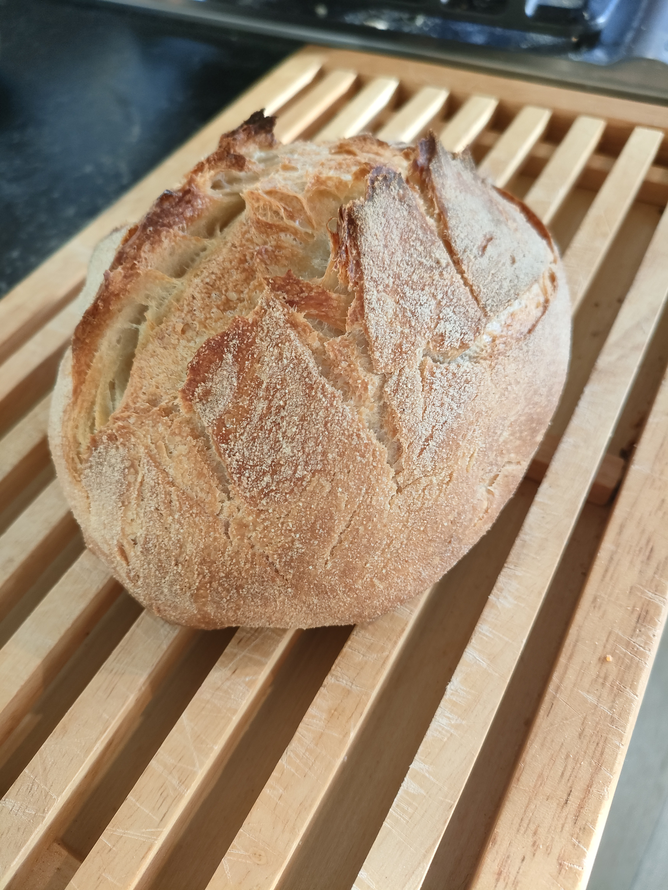
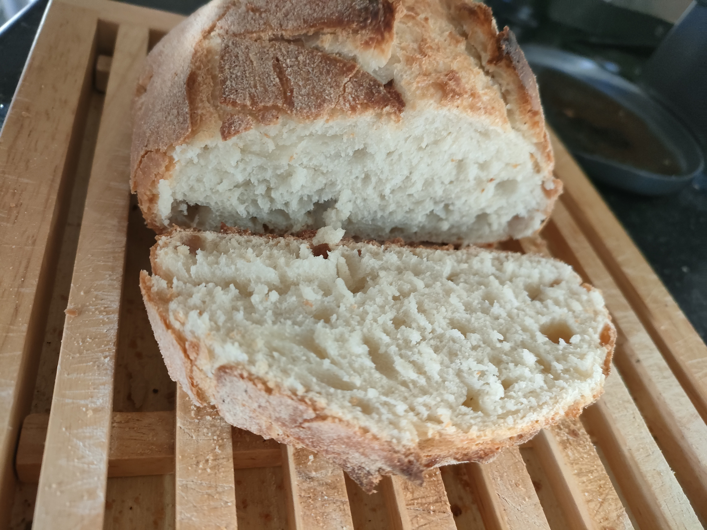
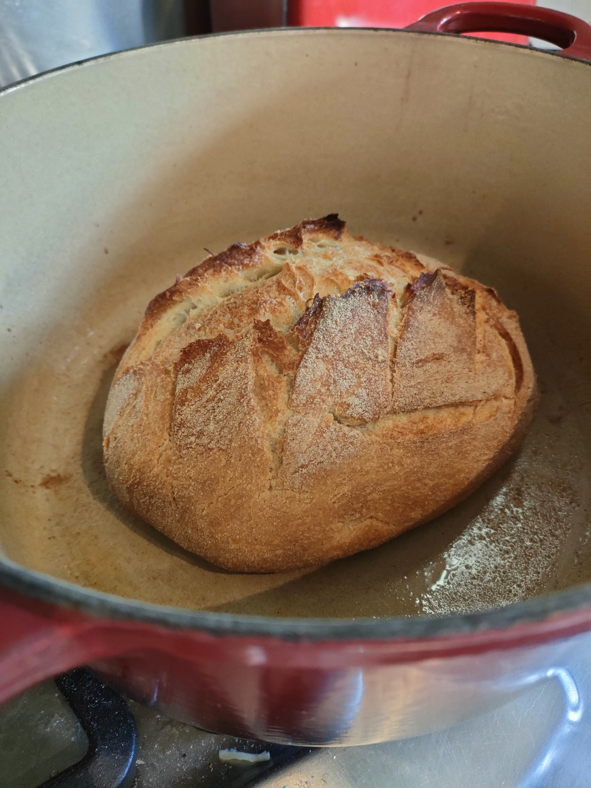

# :fontawesome-solid-bread-slice: Itialaans brood

Geen idee of dit echt itialaans brood is. Ik maak hem in ieder geval met italiaans pizzameel, daarom.  

{ width="500" }
{ width="500" }

### :octicons-list-unordered-16: Ingrediënten

=== ":flatbread: Deeg"

    * 500 gr meel type 00
    * 2 gram verse gist
    * 16 ml olijfolie
    * 8 gr zout
    * 320 ml koud water

### :material-book-clock: Bereiding

Los de gist op in het water en meng met het meel met een handmixer. Laat 20 minuten rusten (autolyse). Dan om de half uur 3/4 keer strech and fold. Dus het deeg van 4 kanten over elkaar heenvouwen en er weer een bol van maken. Daarna in de koelkast 20-48 uur laten rijsen. 

Voordat je gaat bakken laat het deeg 3 tot 4 uur op kamertemperatuur komen. Daarna nog een keer strech en fold en nog een half uur laten rusten.

### :material-fire-circle: Al Forno!

Verwarm de oven op 220 graden. Zet een lege gieteiseren pan erin. Zodra de oven op temperatuur is haal je de pan eruit. Vet hem in met wat olijfolie. Maak van het deeg een mooie vorm, snij in op een paar plekken op de bonvenkant en leg hem in de pan. Doe de deksel erop en zet hem in de oven voor ca 45 minuten. Haal de deksel de laatste 10 minuten van de pan. 

{ width="500" }