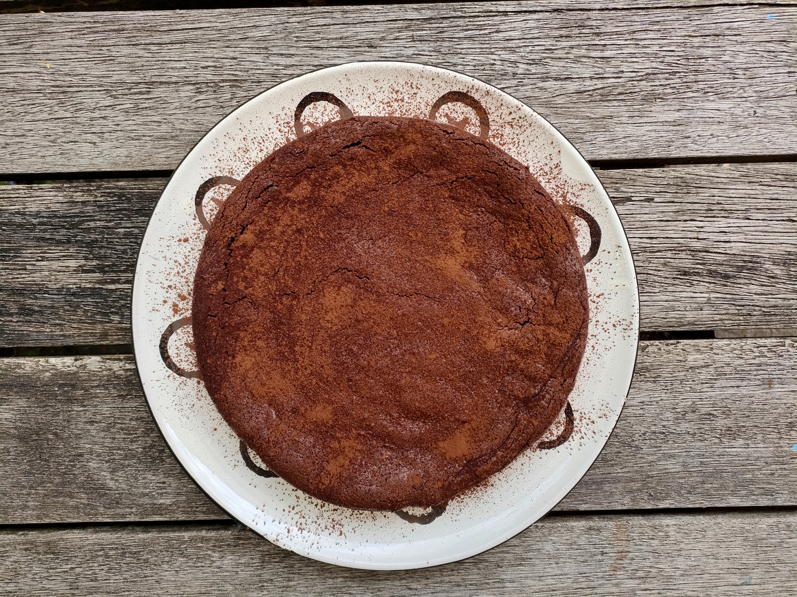
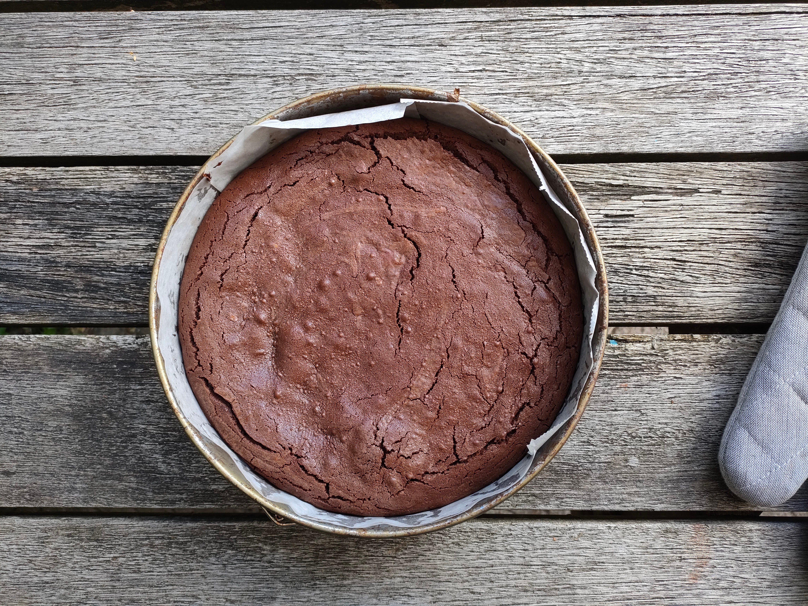
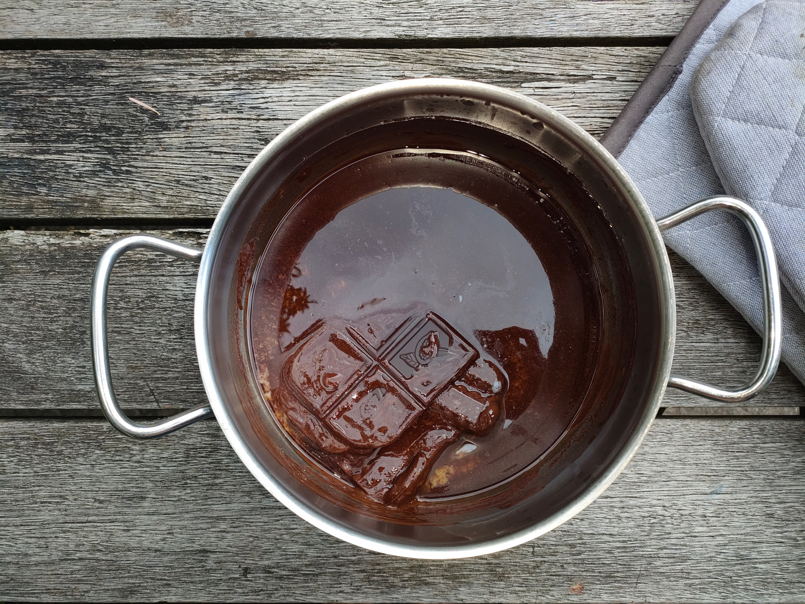
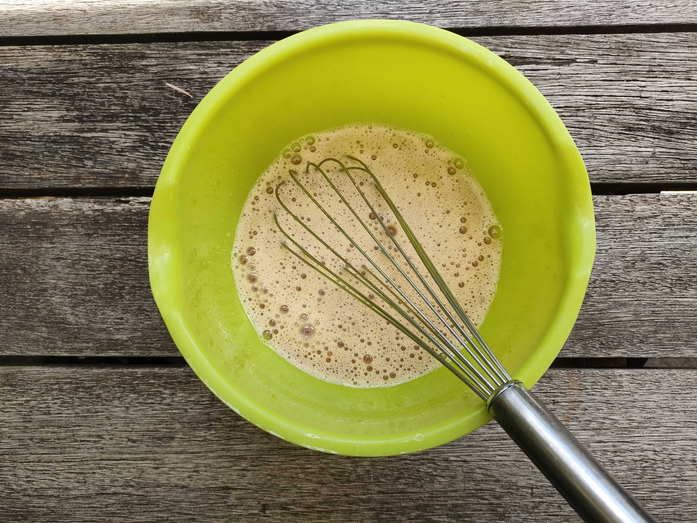
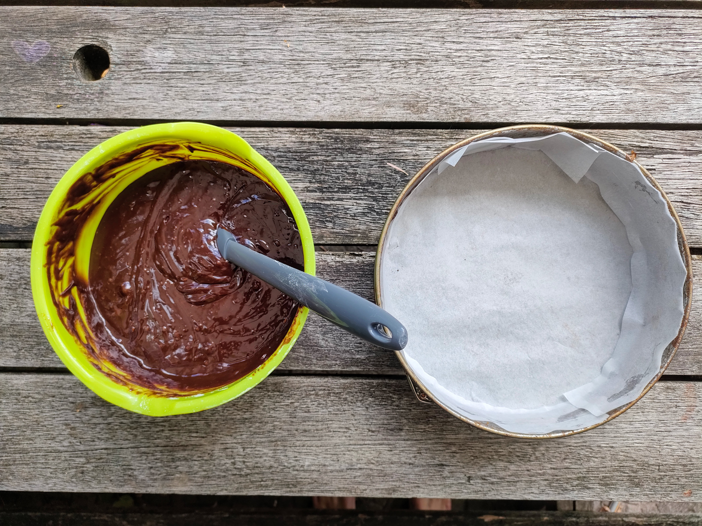
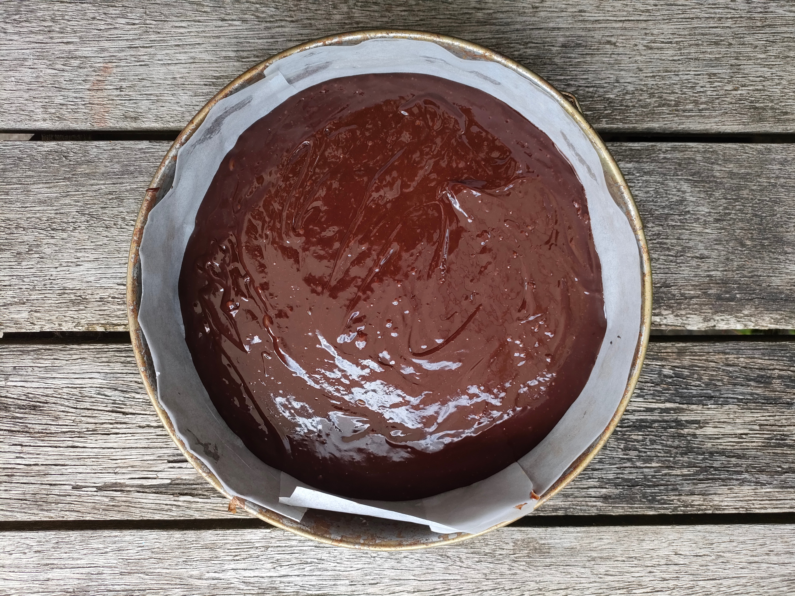

# :material-cookie: Chocolade Taart van Pauline

{ width="300 height="100" }
{ width="300" height="100" }

Dit recept komt van [Rutger bakt](https://rutgerbakt.nl/taart-recepten/chocoladetaart/recept-smeuige-chocoladetaart/). We kregen een stuk op de verjaardag van Erik en vonden hem zo lekker, dat Neel hem voor haar verjaardag wilde hebben. 

### :octicons-list-unordered-16: Ingrediënten 

=== ":material-adjust: Bodem"

    * 325 gr pure choco
    * 250 gr boter
    * 160 gr suiker
    * 5 eieren
    * snufje zout
    * 1 TL vanille-extract
    * 80 gr bloem

### :material-book-clock: Bereiding

Smelt de choco samen met de boter in een waterbad. Meng de andere ingrediënten behalve het meel in een kom. Voeg de gesmolten chocolade toe. Voeg als laatste de bloem toe. Giet in een met bakpapier beklede springvorm. Bak **25-30 minuten bij 180** graden. Zodra de taart klaar en afgekoeld is, bestrooi met cacao.

{ width="300 height="100" }
{ width="300" height="100" }
{ width="300" height="100" }
{ width="300" height="100" }

