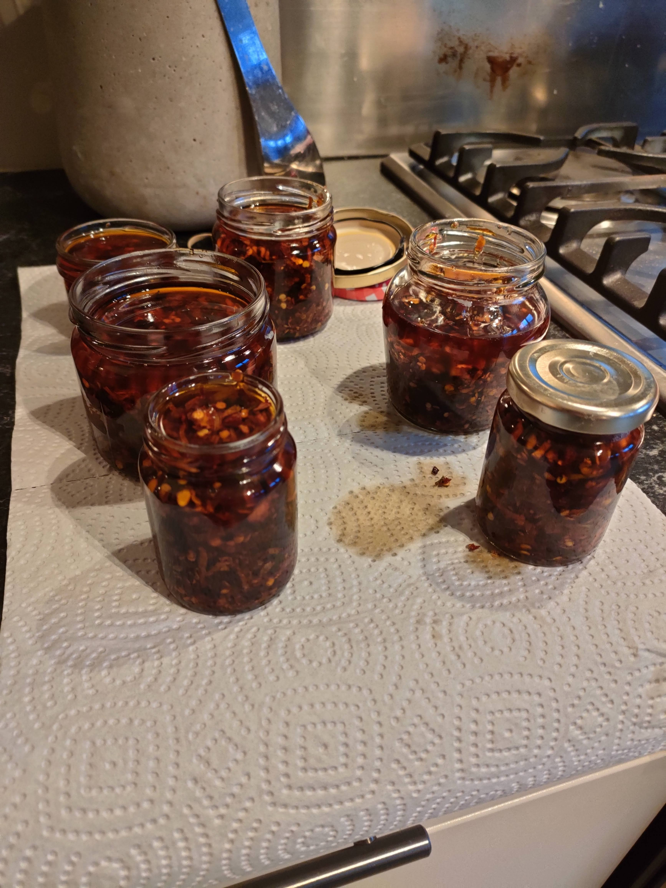

# :material-bowl-mix-outline: Crispy Chilli Oil

{ width="500" height="500" }

Het origenele recept heb ik ooit van Antje gekregen en stamt van [Steffen Henssler](https://www.youtube.com/watch?v=wgjcvBgl2Ws). Zie het als basis. Ik heb bijvoorbeeld macademia olie gebruikt en ook verse pepers erin gedaan. 

### :octicons-list-unordered-16: Ingrediënten

* 350 ml koolzaadolie
* 1 stuk gember
* 1 teentje knoflook
* 2 lenteuitjes
* 4 takjes koriander
* 2 el cashewnoten
* 2 cm kaneelstok
* 1/2 steranijs
* 1/2 tl Szechuanpeper (Szechuan-peperkorrels)
* 50 g chilivlokken
* 25 g gefrituurde uitjes
* 2 el sojasaus
* 1 el bruine suiker

### :material-book-clock: Bereiding

Verwarm de koolzaadolie in een pan. Snijd ondertussen de gember en knoflook fijn. Snijd de lenteuitjes en koriander fijn, inclusief de stelen.

Doe de gember, knoflook, lenteuitjes en koriander in de olie in de pan en bak alle ingrediënten in de hete olie.

Doe in de tussentijd de cashewnoten in een vijzel en stamp ze grof. Plet de kaneelstok licht met de achterkant van een mes en doe hem ook in de vijzel. Voeg een halve steranijs en de Szechuanpeper toe en maal alles samen licht fijn.

Doe de chilivlokken en gefrituurde uitjes in een kom.

Wanneer de gebakken ingrediënten in de pan lichtbruin zijn geworden, voeg je de ingrediënten uit de vijzel toe aan de hete olie en laat je alles kort schuimen. Giet daarna de inhoud van de pan over de chilivlokken en gefrituurde uitjes in de kom, laat het kort opschuimen en roer goed door. Voeg vervolgens de sojasaus en bruine suiker toe en meng alles opnieuw grondig.

Schenk ten slotte de knapperige chili-olie in twee potten en sluit ze af.

